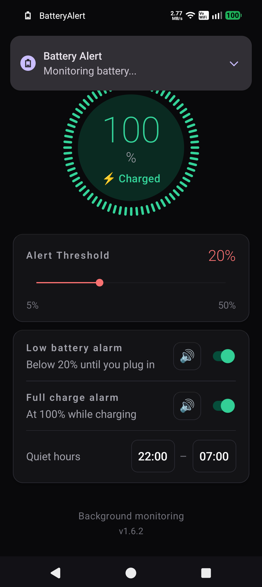

# Battery Alert

An **Android** app that monitors battery level and sounds an alarm when it drops below your chosen threshold. The alarm stops when you plug in your charger.

Built for people who forget to charge their phone and end up with a dead battery during the day.

<p align="center">
  
</p>

## Features

- Custom low-battery threshold (5%–50%)
- Persistent low-battery alarm until you plug in (with optional 5‑minute snooze)
- **Quiet hours** — low-battery alarms wait until the sleep window ends; resumes if still low
- **Full charge** — optional notification at 100% while charging; separate chime if you enable alarm sound
- Background monitoring via a foreground service (works when the app is backgrounded or swiped away)
- Boot receiver restarts monitoring after reboot or app update
- WCAG AA–oriented UI with light/dark theme

## Install

Download the latest APK from [Releases](https://github.com/and/battery/releases).

## Build from source

Requirements: Node.js 22+, Android SDK, JDK 17.

```sh
npm install
npx react-native run-android
```

**Debug APK on a USB device:** the app loads JavaScript from Metro on your computer. Keep `npx react-native start` running, and if the red screen says “Unable to load script”, run:

```sh
adb reverse tcp:8081 tcp:8081
```

Then reload the app. For use without a laptop, build a **release** APK (`assembleRelease`) so the bundle is embedded.

Release APK:

```sh
cd android && ./gradlew assembleRelease
```

The release build expects signing env vars documented in `android/app/build.gradle`.

## Platform scope

This project targets **Android only**. Low-battery alerting, quiet hours, full-charge handling, and alarm previews are implemented in Kotlin foreground services. An iOS tree may exist in the repo for React Native tooling but is not supported.

## License

MIT
